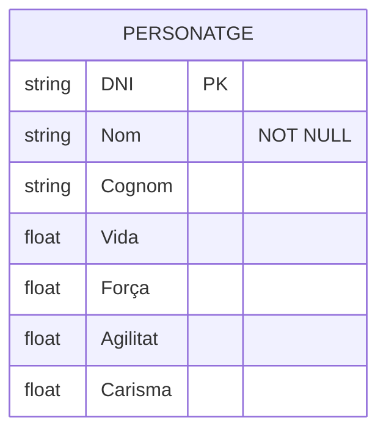
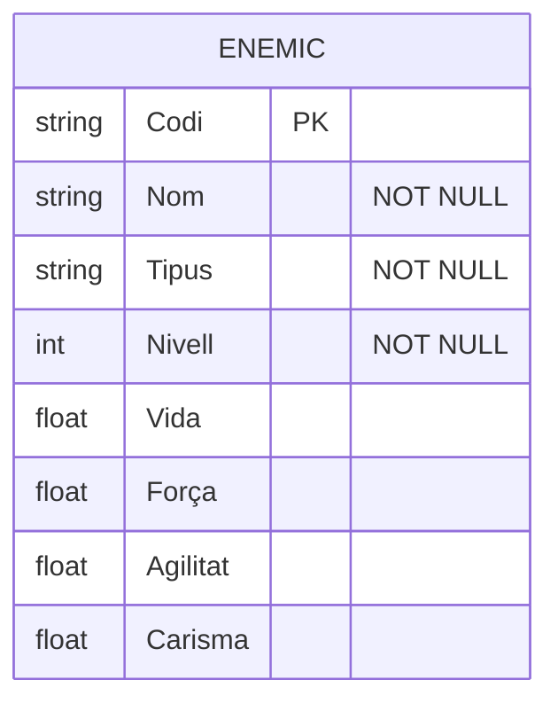
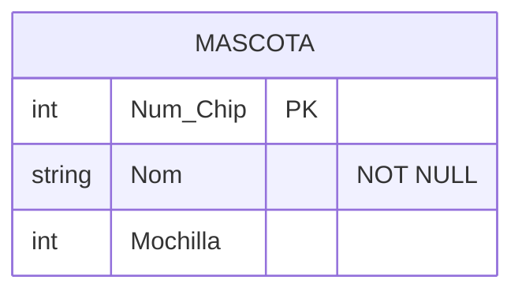
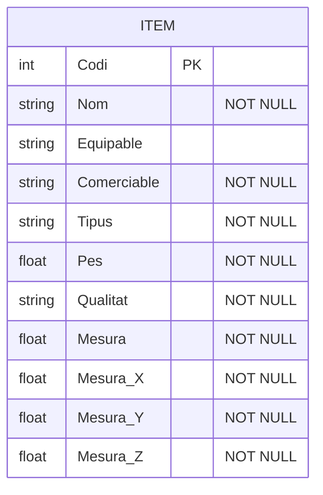
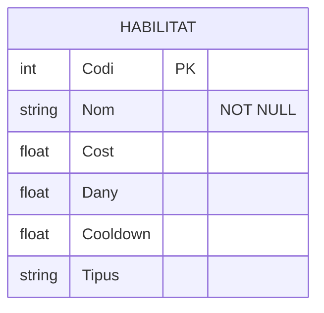
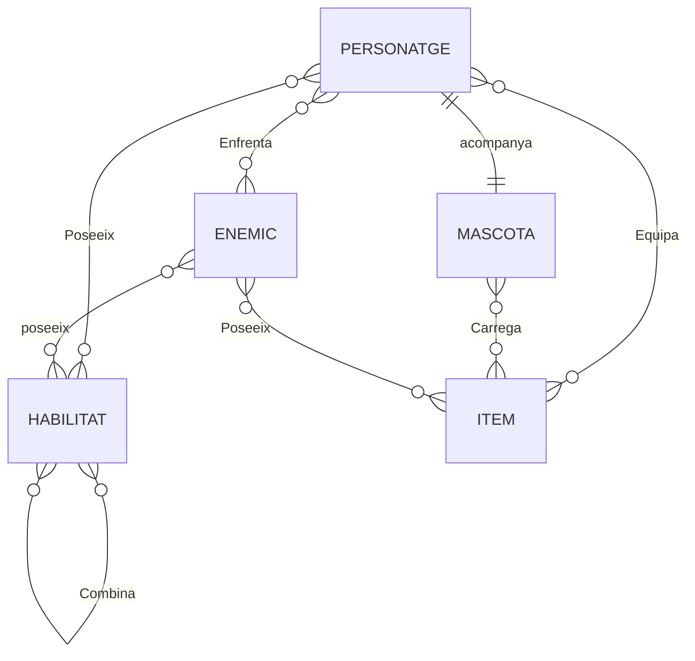
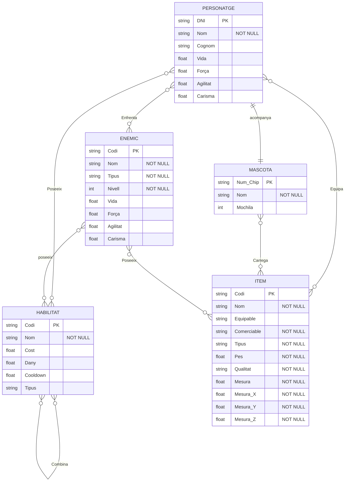

# Diagrama Mermaid GBD

## E. Personatge
 Per fer aquesta entitat he posat el `DNI` que es la Clau Primaria en String, al igual que el `Nom` que es l'unic atribut **NOT NULL**, mentre que tant la `Vida`, la `Força`, l'`Agilitat` i el `Carisma` poden arribar a ser valors amb decimal en aquest cas.

## E. Enemic
 Per l'entitat *Enemic* he utilitzat el mateix codi que a *Personatge* treient el `Cognom` i afegint `Tipus` i `Nivell`.

## E. Mascota
 Per l'entitat *Mascota* he utilitzat la clau primaria de `Num_Chip` amb int perquè s'utilitzan números per el Chip que no poden contenir decimals, el `Nom` ho he reutilitzat a totes igual i la `Motxilla` té l'int per el número de items que pot carregar

## E. Item
 Per l'entitat *Item* la clau primaria `Codi` es un int per catalogar millor l'ordre d'objectes afegits, no tots els items son equipables així que `Equipable` no es **NOT NULL**, a diferencia del `Tipus`,`Si es comerciable` o el `Pes` que es obligatori, després, les `Mesures` con el `Pes` son float perque es por pesar 21.11kg i mesurar `mesura_Z` 52cm d'amplada, `mesura_Y` 125cm d'alçada i `mesura_X` 64cm de llarg.

## E. Habilitat
 Per l'entitat *Habilitat*, la clau primaria, `Codi` és com a *Item*, el `Nom` igual que tots els altres, el `Cost`,`Dany` i `Cooldown` poden tenir decimals com que fasi 10.5 de `Dany` o trigar 12.5s de `Cooldown` i el `Tipus` és igual que en *Item*.

## Relacions
 ### Les relacions son:
 *Personatge* ***N-M*** *Habilitat* amb posibilitat de no tenir.
 
 *Personatge* ***N-M*** *Item* podent tenir molts items o no tenir cap.
 
 *Personatge* ***1-1*** *Mascota*, el personatge sempre té la seva mascota inicial i no pot portar més d'una o no emportar cap.
 
 *Personatge* ***N-M*** *Enemic*, qualsevol personatge pot lluitar amb molts enemics i el mateix per els enemics.
 
 *Mascota* ***N-M*** *Item*, la mascota pot carregar molts items diferents.
 
 *Enemic* ***N-M*** *Item*, els enemics poden portar molts items.
 
 *Enemic* ***N-M*** *Habilitat*, els enemics poden utilitzar més d'una habilitat.
 
 *Habilitat* ***N-M*** *Habilitat*, les habilitat poden tenir sinergies amb altres habilitats.

## Codi senser

